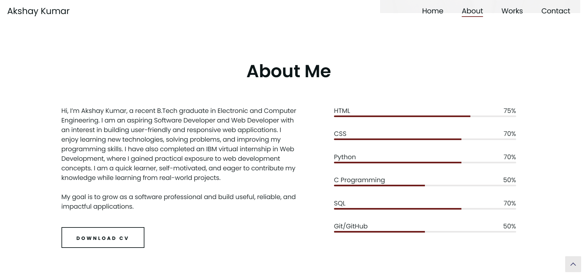

# Akshay Kumar | Software Developer Portfolio

## Portfolio Preview

### Desktop View


### Mobile View


### About Me Section


Welcome to my personal portfolio repository!

I am **Akshay Kumar**, a B.Tech graduate in Electronics and Computer Engineering (2026), passionate about Software Development, Web Development, and building innovative technology solutions.

This portfolio showcases my technical skills, academic projects, education, and professional journey.

## 🌐 Live Portfolio

**Website:** https://78akshay.github.io/akshay-portfolio/

## 👨‍💻 About Me

- 🎓 B.Tech in Electronics and Computer Engineering — 2026
- 💻 Aspiring Software Developer & Web Developer
- 🌍 Based in New Delhi, India
- 🏢 Completed IBM Virtual Internship in Web Development
- 🚀 Quick learner, self-motivated, and passionate about technology

## 🛠️ Technical Skills

**Programming Languages:** C, C++, Python, JavaScript, SQL

**Web Technologies:** HTML5, CSS3, JavaScript, React.js, Node.js

**Tools & Platforms:** Git, GitHub, VS Code, XAMPP

**Hardware & IoT:** Arduino, ESP32, Sensors, IoT Systems

## 🚀 Featured Projects

### 1. GIS-Based Digital Finance Platform
A digital finance platform project incorporating GIS-based features to support location-aware financial services.

### 2. Smart Automatic Irrigation System
An IoT-based irrigation system designed to automate water supply using sensor-based monitoring.

### 3. Arduino Password Door Lock
A password-protected security system developed using Arduino to control door access.

### 4. Smart Energy Meter
An energy monitoring project designed to measure and track electricity consumption.

## ✨ Portfolio Features

- Responsive design for desktop and mobile devices
- About Me, Skills, Education, and Projects sections
- Downloadable resume
- Interactive animations
- Social media integration
- Working contact form using EmailJS
- Hosted on GitHub Pages

## 🧰 Technologies Used

- HTML5
- CSS3
- JavaScript
- EmailJS
- AOS Animation Library
- Git & GitHub
- GitHub Pages

## 📂 Project Structure

```text
akshay-portfolio/
├── index.html
├── css/
│   ├── main.css
│   ├── media.css
│   └── reset.css
├── js/
│   ├── main.js
│   ├── form.js
│   └── skillbar.js
├── img/
├── resume/
│   └── Akshay_Kumar_Resume.pdf
└── README.md
```

## 💻 Run Locally

1. Clone this repository:

```bash
git clone https://github.com/78Akshay/akshay-portfolio.git
```

2. Open the project folder in VS Code.
3. Open `index.html` using the Live Server extension.

## 📬 Connect With Me

**GitHub:** https://github.com/78Akshay

**LinkedIn:** https://www.linkedin.com/in/akshay-kumar-60920a408/

**Portfolio:** https://78akshay.github.io/akshay-portfolio/

**Instagram:** https://www.instagram.com/_akshay_kum_ar00/

## 🙏 Acknowledgements

This portfolio was customized from the Simple Developer Portfolio Template. Thanks to the original template creator for the starting design.

---

⭐ If you like my portfolio, feel free to explore the repository!

**© 2026 Akshay Kumar**